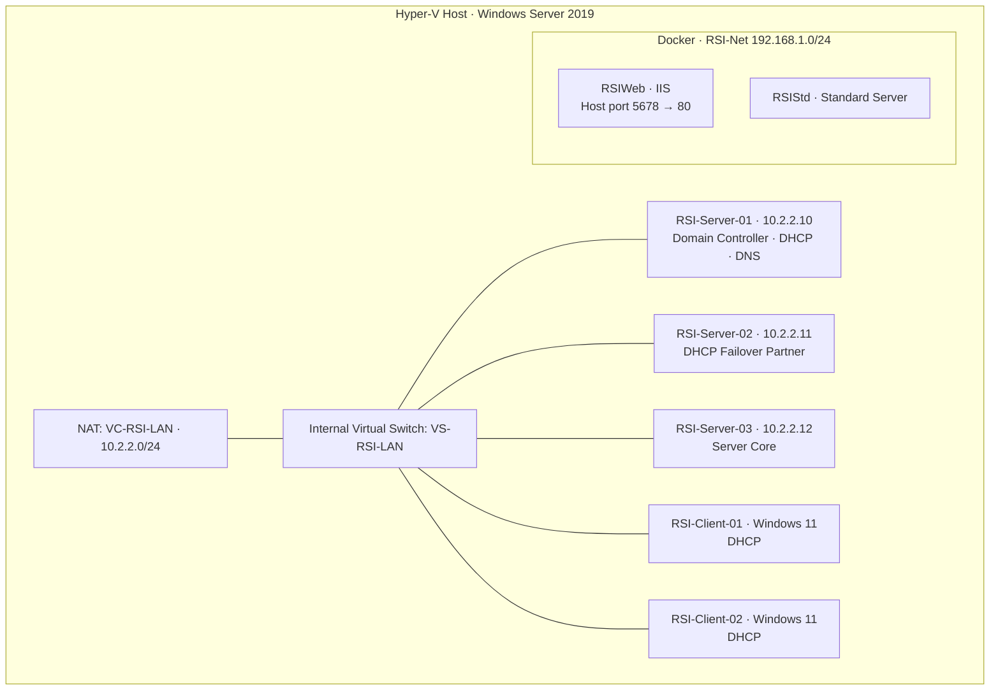
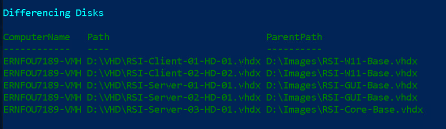
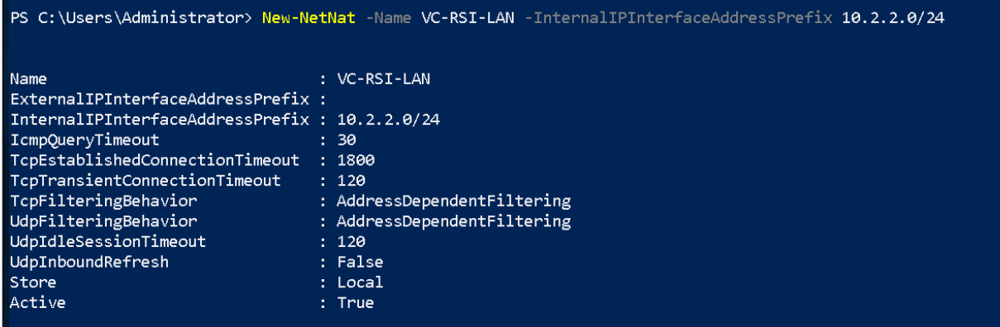
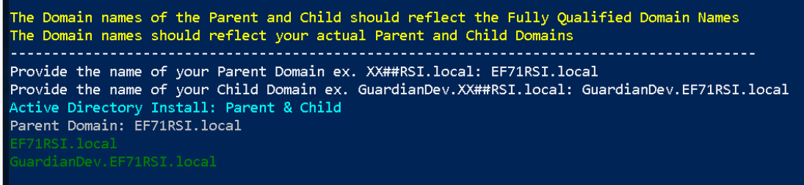
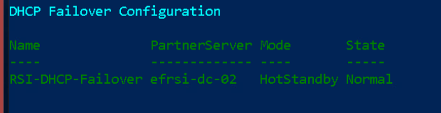
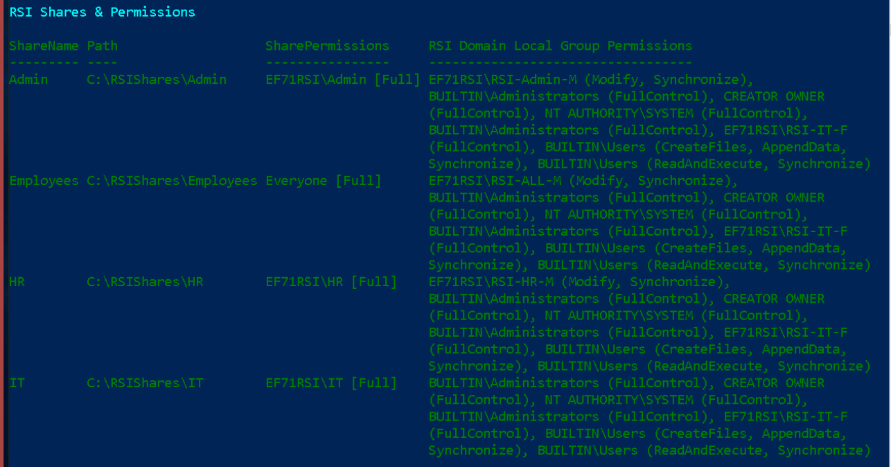
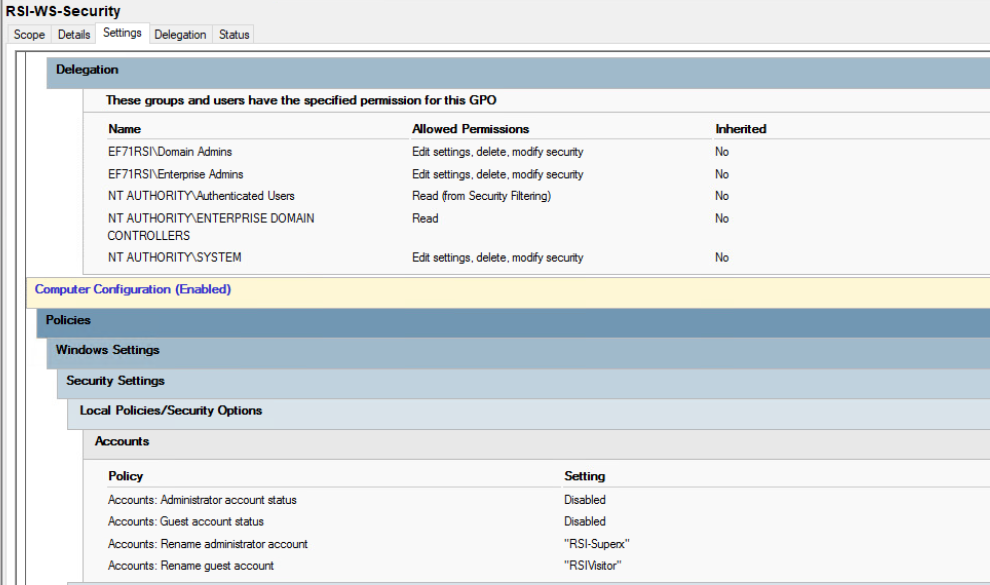
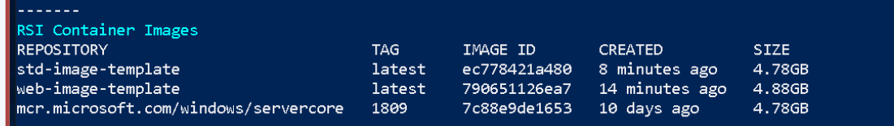
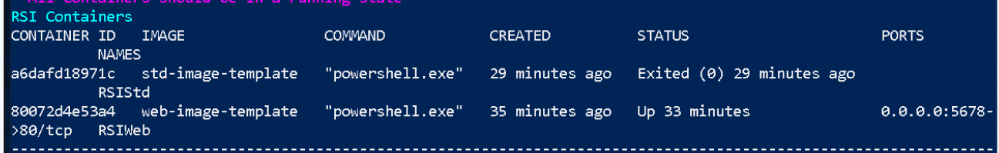
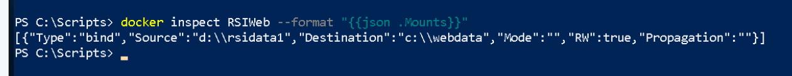

# RSI Enterprise Windows Infrastructure Lab 🖥️🏢
**Academic Project, ECPI University (CYB360)** | Systems Administration | Dec 2025 – Jan 2026

## 📋 Overview
Over five weekly phases, I built a complete Windows Server environment for a fictional company, **RSI**, and its subsidiary **Guardian**, on a single Hyper-V host. The build covers virtualization, networking, a parent/child Active Directory forest, DHCP with failover, DNS, file shares, Group Policy, and Windows containers with Docker. Each phase was verified with PowerShell and documented in a weekly report for stakeholders.

## 🛠️ Technologies
`Windows Server 2019` `Hyper-V` `PowerShell` `Active Directory Domain Services` `DHCP (Failover)` `DNS` `Group Policy` `NTFS & Share Permissions` `Docker` `Windows Server Core Containers` `IIS`

## 🗺️ Network Diagram

## Phase 1: Hyper-V & Virtual Machine Configuration
- Installed the Hyper-V role and set separate folders for base images (`D:\Images`), virtual hard disks (`D:\VHD`), and VMs (`D:\VM`)
- Built three **base images** (Server GUI, Server Core, Windows 11) and created five VMs from **differencing disks** to save storage
- Applied a consistent naming standard (`RSI-Server-0X`, `RSI-Client-0X`, `-HD-0X.vhdx`)

| Base image | VMs built from it |
|---|---|
| RSI-GUI-Base.vhdx | RSI-Server-01, RSI-Server-02 |
| RSI-Core-Base.vhdx | RSI-Server-03 |
| RSI-W11-Base.vhdx | RSI-Client-01, RSI-Client-02 |

## Phase 2: Networking & Active Directory Prerequisites
- Created internal virtual switch **VS-RSI-LAN** and a **NAT** network (10.2.2.0/24) on the host
- Connected all VMs to the switch and assigned static IPs to the servers
- Installed the AD DS role on all three servers and activated Windows Server

## Phase 3: Active Directory, DHCP, DNS & Shares
- Built a **parent/child forest**: `EF71RSI.local` and `GuardianDev.EF71RSI.local`
- Created OUs, security groups, and users for each department (Admin, HR, IT, Engineering, Operations) with a naming standard
- Joined both workstations to the domain in the **RSIWorkstations** OU
- Configured **DHCP with failover** (Hot Standby) between two servers, with scope options for router, DNS, and domain name
- Created departmental **file shares** with group-based share and NTFS permissions
- Added a DNS **reverse lookup zone** (2.2.10.in-addr.arpa)

## Phase 4: Group Policy & Docker
- **RSI-WS-Security GPO** (linked and enforced on RSIWorkstations): disables the built-in Administrator and Guest accounts, renames both, and uses Restricted Groups to control Remote Desktop Users
- **RSI-WS-Updates GPO**: automatic updates every Friday at 01:00 from an internal update server
- Installed Docker, pulled Windows Server Core, and built two reusable images: **web-image-template** (with the IIS Web Server role) and **std-image-template**
- Created host folders for container bind mounts

## Phase 5: Finalizing Docker Containers
- Deployed **RSIWeb** from the web template, publishing container port 80 on host port 5678
- Deployed **RSIStd** from the standard template
- Created a separate Docker NAT network, **RSI-Net** (192.168.1.0/24), for the standard server
- Attached persistent **bind mounts**: `D:\RSIData1 → C:\webdata` (RSIWeb) and `D:\RSIData2 → C:\stddata` (RSIStd)

## 📸 All Screenshots
Every verification screenshot is in this repository, named by phase (p1 through p5).

## 💡 Skills Demonstrated
Windows Server administration · Hyper-V virtualization · Active Directory design · DHCP & DNS · Group Policy hardening · File share permissions · PowerShell verification · Docker containers · Technical documentation
